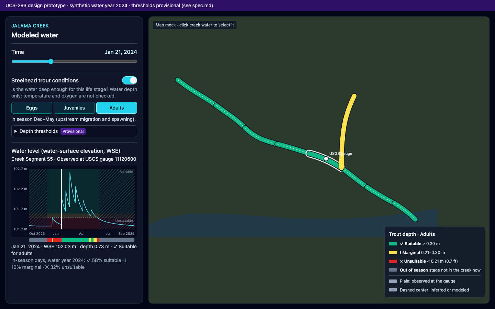
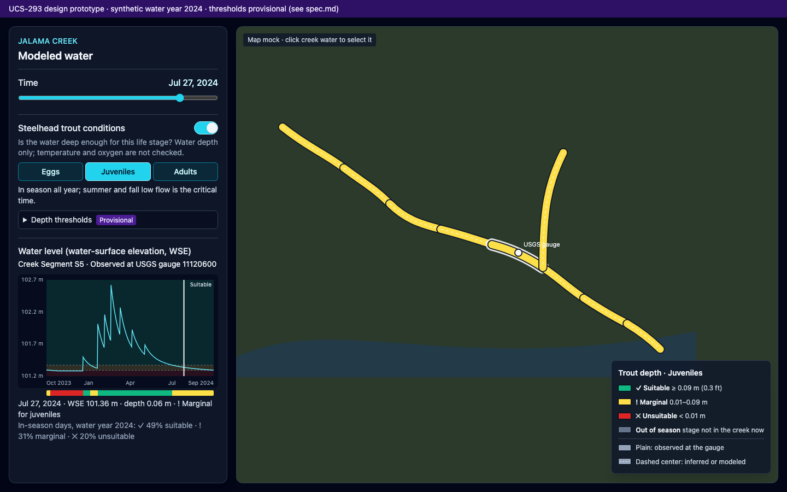

# UCS-293 · Steelhead trout conditions: design spec

Status: first slice implemented in `apps/creek-visualization-browser` (see "Implemented slice"); thresholds reconciled to the research document. Prototype: [prototype.html](prototype.html) (standalone; open in a browser; synthetic data).

## Recommendation in one paragraph

Add one **Steelhead trout conditions** section to the sidebar: an on/off switch plus a three-way life-stage control (**Eggs · Juveniles · Adults**). When the switch is on, the same rule colors two places. (1) The Water-Surface Elevation Chart gets red/yellow/green horizontal background bands for the Selected Creek Segment, hatched where the life stage is out of season, plus a one-row daily suitability strip and an in-season summary. (2) The map's creek water is recolored Suitable/Marginal/Unsuitable/Out of season at the selected time, with a matching legend. The rule classifies **water depth** (water-surface elevation (WSE) minus the segment's bed elevation) against provisional, life-stage-specific depth thresholds. It says nothing about temperature, dissolved oxygen, or survival, and the UI says so.

## Why depth, and where it comes from

Published steelhead criteria are depths. The app stores WSE in m NAVD88 (North American Vertical Datum of 1988), so the bridge is `depth = WSE − bed elevation` at the segment's WSE Anchor Point.

| Water | WSE | Bed elevation already in the app |
|---|---|---|
| Modeled | Modeled WSE per Creek Segment | `anchorBedElevationM` (`sloped-water-surface.ts`) |
| Observed (gauge segment) | Gauge height + gauge datum | `gaugeBedElevationM` (`creek-data-contract.ts`) |
| Inferred neighbours | Bed + observed depth (Creek Segment Observed WSE Propagation) | `bedElevationM` per propagation node |

Chart bands are drawn in WSE space: each band edge is `bed + threshold`, so bands stay correct under the existing m/ft NAVD88 unit toggle.

## Thresholds (reconciled to the research document)

**The Linear document "Steelhead Trout Conditions Research Result" (28d07104-ee40-46cc-bcf0-c8a553a5ebf6) is canonical for this build.** It is marked *UNDER HUMAN REVIEW (AI generated)*, so every value is provisional; the UI and the code comments say so. Constants live in `apps/creek-visualization-browser/src/steelhead-trout-conditions.ts`.

| Life stage | In season | Unsuitable | Marginal | Suitable | Research basis |
|---|---|---|---|---|---|
| Eggs | Jan–May (spawning) | < 15 cm (6 in) | 15–36 cm | ≥ 36 cm (14 in) | Eggs are laid in the nest the adult builds, so the spawning depth stands in for them: ~14 in (36 cm) optimum, range 6–36 in, too shallow prevents nest building. Marginal is the span between the 6 in minimum and the optimum (derived, not a published band). Egg incubation also needs temperature and oxygen, which the app does not carry; the UI says so. The "≥ 8 in" in the gravel row is gravel depth and is not used. |
| Juveniles | year-round (summer low flow is the limiting season) | < 1 cm (no water over the bed) | 1–25 cm | ≥ 25 cm (10 in) | Rearing pool depth: juveniles prefer 10–20 in; deep pools critical; shallow warm pools lose oxygen. The research gives no shallower cutoff, so Unsuitable is the app's own dry threshold (`DRY_BELOW_DEPTH_M`), not a research value. Deeper is not penalized. |
| Adults | Dec–May | < 18 cm (7 in) | 18–36 cm | ≥ 36 cm (14 in) | Migration depth ≥ 7 in (18 cm), shallower blocks passage; spawning depth ~14 in (36 cm) optimum, range 6–36 in. Marginal is the span between the two research values (derived, not a published band). |

Season: a stage's months are the research's population-wide timing for Southern California steelhead, not an observation at Jalama Creek, so the UI calls them *typical*: Eggs read "Typical steelhead spawning season: Jan–May" (peak Feb–mid-Apr), Adults read "Typical steelhead run season: Dec–May" (upstream run peaks Jan–Mar). Eggs stay in the gravel after spawning and the research gives no incubation length, so the Jan–May window is when nests are built, not when eggs are present. Outside the typical season the map shows gray ("Outside typical season") and the chart hatches that time.

### What changed from the first draft

| Item | First draft | Now (research document) |
|---|---|---|
| Adults Unsuitable edge | 0.21 m (CDFW 0.7 ft passage) | **0.18 m** (7 in migration depth) |
| Adults Suitable edge | 0.30 m ("provisional margin") | **0.36 m** (14 in spawning optimum) |
| Adults season | Dec–May | Dec–May (unchanged) |
| Juveniles Suitable edge | 0.09 m (CDFW 0.3 ft) | **0.25 m** (10 in preferred pool depth) |
| Juveniles Marginal band | 0.01–0.09 m | **0.01–0.25 m** |
| Juveniles season | all year, Jun–Nov critical | year-round, summer limiting (research gives no months) |
| Eggs | 0.09 / 0.24 m, Jan–Jun | first pass on the research document: no depth band. Now **0.15 / 0.36 m, Jan–May**, using the spawning depths as a stand-in for the nest (FBT-025 found that "no band" read as a bug) |
| Citations | CDFW, Bjornn & Reiser, USBR, CalSalmon | the research document's citations (Hanson 2003, SCR Parkway, Stoecker 2002, CalTrout 2021) |

The prototype and the two mockup PNGs still show the first-draft numbers; they are superseded by this table.

### Implemented slice (UCS-293)

- Sidebar section "Steelhead trout conditions" above the chart: checkbox, Eggs / Juveniles / Adults buttons, season line, depth ranges, "Where the ranges come from", and the review caveat.
- Chart: red / yellow / green bands behind the line for the selected segment, hatch over out-of-season time, depth and class in the hover readout, white time cursor while on.
- Map: modeled and observed water (including inferred neighbours) recolored by the segment's class at the selected time; legend swaps to the trout key; selection halo turns white.
- Depth = WSE − bed elevation. Bed comes from the observed propagation file (gauge and inferred neighbours) and from the modeled Time Series' optional `anchorBedElevationM`. A segment without one is "not rated": standard blue on the map and a note in the sidebar. The default modeled method currently carries no bed.
- Not built yet: suitability strip and in-season summary, dashed center line separating observed from inferred or modeled, red ribbon for dry segments, per-cross-section riffle width, upper limits.

## Science and data gaps

1. **The research document is itself under human review (AI generated).** Every number above is provisional until a fisheries biologist confirms it.
2. **Deepest point vs. riffle width.** CDFW passage depth must hold across ≥ 25% of a *riffle's* width. The app's depth is the deepest point (thalweg) at one cross-section, which overstates passability, so the Adults Marginal band is that uncertainty. Fixing this properly needs per-cross-section width-at-depth from USGS 3DEP (3D Elevation Program).
3. **The lidar "bed" is the water surface.** USGS 3DEP lidar does not see underwater, so where water was present on the flight date (Sept 2018), bed elevation is too high and depth is under-reported. This is small for Jalama's dry-season channel but unknown.
4. **No upper limits.** Eggs also die from bed-scouring high flows, and fry are flushed by high velocity. The band model supports an upper red band, but no level-based threshold was found. Velocity needs Manning's equation outputs the browser does not yet carry.
5. **Depth is not survival.** Water temperature (the gauge measures it, but it is not ingested), dissolved oxygen, pool cover, and sandbar (lagoon mouth) breaching control survival and passage at Jalama. The UI copy must not say "survivability."
6. **Jalama-specific timing and the BPG (Biogeographic Population Group) assignment** need fisheries-biologist confirmation (already noted under Distinct Population Segment in the glossary).

## Sidebar controls

- **Placement:** a new section between **Time** and the chart, because it changes both the chart and the map. Proximity (Gestalt) puts it next to what it affects.
- **Switch** (`role="switch"`), off by default. Off keeps today's app exactly as it is (blue water, amber selection).
- **Life stage** (`role="radiogroup"`), Eggs · Juveniles · Adults in life-cycle order, default Adults. The buttons reuse the unit toggle's cyan `aria-checked` styling (consistency, Nielsen heuristic 4). They are disabled while the switch is off.
- **Season line** under the control, such as "Typical steelhead spawning season: Jan–May" (Eggs) or "Typical steelhead run season: Dec–May" (Adults).
- **Depth thresholds** `
` with a **Provisional** badge: the three ranges and their sources (visibility of system status, plus honesty about uncertainty).
- **Scope line:** "Water depth only; temperature and oxygen are not checked."

## Water-Surface Elevation Chart

- **Bands:** three full-width horizontal rectangles at 16% fill opacity under the line, with dashed edge lines and right-aligned labels. A label is hidden when its band is shorter than 14 px; the strip and legend still carry the class.
- **Axis:** with bands on, the elevation domain always includes the bed and the Suitable edge + 5 cm, so a record that never reaches "enough" still shows where enough is.
- **Out-of-season time:** dark diagonal hatch over the bands. Bands answer "how deep relative to need"; the hatch answers "does the need apply now."
- **Suitability strip:** a 10 px row under the plot, aligned to the plot's x-range, with one cell per time step colored by class, including Out of season in gray. It is the at-a-glance "which periods were good" answer the request asked for.
- **Readouts:** hover and selected-time text append depth plus class with a glyph: `Jan 22, 2024 · WSE 101.99 m · depth 0.69 m · ✓ Suitable for adults`.
- **Summary:** `In-season days, water year 2024: ✓ 58% suitable · ! 10% marginal · ✕ 32% unsuitable`, computed over the chart's shown window.
- **Cursor:** white while trout mode is on, because amber reads as Marginal.

## Map and legend

- **Water color** becomes the class color at the selected time: Suitable `#10b981`, Marginal `#fde047`, Unsuitable `#dc2626`, Out of season `#64748b`, with a dark `#0f172a` casing so yellow and green hold up over imagery.
- **Observed vs. inferred/modeled:** every source keeps the **full** class color. The prototype showed that fading yellow to about 60% reads as olive, which looks like a different class. Source is a second visual channel: inferred and modeled water add a dashed light center line. In the 3D scene, use a `FillSymbol3DLayer` pattern or outline for non-observed water.
- **Dry segments** draw no water polygon today. In trout mode, a dry in-season segment must still show **Unsuitable**: draw its centerline ribbon in red (the existing centerline overlay is the natural host).
- **Selection highlight:** white halo in trout mode, amber otherwise (`SELECTED_CREEK_SEGMENT_HIGHLIGHT_COLOR`).
- **Legend** (replaces the water rows while on): title `Trout depth · Adults`; four class rows with glyph, name, and range; a divider; then `Plain: observed at the gauge` and `Dashed center: inferred or modeled`. The existing Drainage-Area Ratio Transfer row stays as a third source note.

## Accessibility

- Red and green alone fail for deuteranopia (red-green color blindness). The classes also differ in lightness (yellow lightest, emerald middle, red darkest) and always carry a glyph (✓ ! ✕ –) and a word in the readout, strip tooltip, and legend.
- Switch and radiogroup are keyboard-operable with visible focus (the existing `focus-visible:outline-cyan-300` pattern). The chart's `aria-label` names the active life stage.

## Proposed glossary terms (need your approval; glossary not edited)

The concept is classifying one Creek Segment's water depth at one time against one steelhead life stage's depth thresholds. No existing term covers it, and "trout survivability" overclaims (gap 5).

Candidates: Steelhead Depth Suitability · Life-Stage Depth Suitability · Trout Depth Suitability Class · Steelhead Water-Depth Rating · Steelhead Habitat Depth Class · Steelhead Depth Condition · Trout Survivability (rejected).

**Recommended: Steelhead Depth Suitability.** Proposed definition: *a class (Suitable, Marginal, Unsuitable, or Out of season) given to a Creek Segment at a selected time by comparing its water depth (WSE minus bed elevation at the WSE Anchor Point) to the depth thresholds and season of one Steelhead Life Stage (Eggs, Juveniles, or Adults). Depth only; it does not account for temperature, oxygen, or velocity, and its thresholds are provisional.* A companion term, **Steelhead Life Stage**, names the three modes.

## Implementation sketch (for the follow-up ticket)

- `steelhead-depth-suitability.ts`: the threshold and season config plus a pure function `(lifeStage, depthM, timeUtcMs) → class`. Unit-testable with no scene.
- `water-surface-elevation-chart.ts`: an optional `bands` input (edges in m NAVD88 plus out-of-season spans), drawn under the line, and the strip and summary. The chart stays unaware of trout.
- `modeled-water-scene-renderer.ts` / `arcgis-scene-renderer.ts`: a symbol override by class. `creek-segment-selection.ts`: a highlight color parameter.
- `index.html`: the new sidebar section and legend rows, styled with Tailwind utilities, reusing `.info-tip-*`. No component library is involved.
- Tests: none are proposed here. Feature Behavior Tests (for example, "Turning on trout conditions colors the selected creek segment's water by its depth class") will be proposed with their identifiers and methodology for approval in the implementation ticket.

## Linear comment draft (UCS-293)

> Design proposal ready: `docs/design/ucs-293-steelhead-depth-suitability/` (spec.md + interactive prototype.html). One "Steelhead trout conditions" switch plus an Eggs/Juveniles/Adults selector drives (1) red/yellow/green depth bands, out-of-season hatching, and a daily suitability strip on the WSE chart, and (2) class-colored creek water and a legend on the map. The rule classifies depth = WSE − bed, using provisional thresholds: adults 0.21/0.30 m (CDFW passage 0.7 ft), juveniles 0.01/0.09 m (CDFW 0.3 ft), eggs 0.09/0.24 m (spawning depth ≥ 24 cm). Open items: reconcile with the research doc, deepest-point vs. 25%-riffle-width depth, the lidar bed bias, missing upper (scour/velocity) limits, and approval of the "Steelhead Depth Suitability" glossary term.

## Mockups

